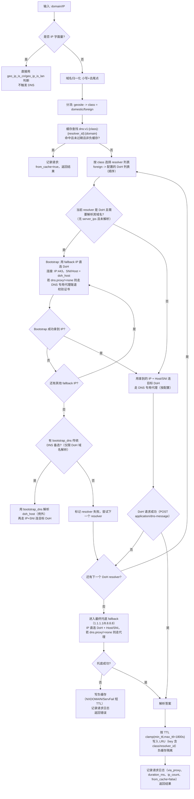

# DNS 模块增强设计（Spec）

## 1. 概述
将现有 `core/dns` 从“解析工具函数”升级为自包含的 DNS 模块：支持国内/国外分流、多 DoH 上游、用 `1.1.1.1`/`8.8.8.8` IP 直连 DoH 作为最终托底及解析国外 DoH 域名的 bootstrap、DNS 专用代理、LRU+TTL 缓存、请求记录，以及管理面可观测性（缓存列表 + 请求记录）。

## 2. 范围
- 域名/IP 查询分流（`geosite` / `geo_ip`）
- 多 DoH（RFC 8484，POST/GET base64url）
- Bootstrap：国外 DoH 域名无 `server_ips` 时，使用 `https://1.1.1.1/dns-query`、`https://8.8.8.8/dns-query` **IP 直连 DoH**（Host/SNI = 目标 DoH 域名）
- 最终托底：国外域名且全部配置 DoH 失败时，仅用上述 IP 直连 DoH
- DNS 专用代理：`dns.proxy = "none" | "upstream:<id>"`，托底及用托底解析 DoH 域名时默认走代理（复用 `upstream` 池）
- 缓存：LRU 1020? 容量 1024，`dns:v1:{class}:{resolver_id}:{domain}`，TTL clamp（60s~1800s），负缓存（NXDOMAIN/ServFail 10~60s）
- 请求记录：环形缓冲区（默认 256），字段见下文
- 管理面：缓存列表 + 请求记录（B）
- 可测试：传输层注入，保留 `dns_set_resolver`，单测零网络

## 3. 架构
| 文件 | 职责 |
|---|---|
| `include/rybaproxy/dns.h | 对外接口（dns_resolve、配置、缓存、请求记录），保留旧接口 |
| `src/core/dns.c` | 分流、resolver 选择、bootstrap、代理调度、缓存、请求记录、fallback |
| `src/core/dns_doh.c`（必要时） | RFC 8484、HTTP/TLS 细节、传输接口 |
| `src/web/web_api.c` | 管理面 API（缓存列表、请求记录、刷新/清空、配置） |

## 4. 配置
```jsonc
{
  "dns": {
    "proxy": "none",
    "bootstrap_dns": ["223.5.5.5", "119.29.29.29"],
    "nameservers": [
      { "type": "doh", "url": "https://dns.example.com/dns-query", "host": "dns.example.com", "server_ips": ["203.0.113.1"], "proxy": "inherit" }
    ],
    "fallback": ["ip://1.1.1.1", "ip://8.8.8.8"],
    "cache_size": 1024,
    "cache_max_ttl_sec": 1800,
    "cache_min_ttl_sec": 60,
    "log_size": 256
  }
}
```
约定：`proxy: inherit` 复用 `dns.proxy`。不使用业务域名解析链路去解析 DoH 域名。

## 5. 解析流程（详细）


> 注意：用托底解析 DoH 域名以及最终托底本身，若配置了 DNS 专用代理则**默认走代理**（A）。业务域名的解析决策不依赖其解析链路。

## 6. 数据结构
```c
typedef enum { DNS_CLASS_AUTO=0, DNS_CLASS_DOMESTIC=1, DNS_CLASS_FOREIGN=2 } dns_class_t;
typedef enum { DNS_NS_DOH, DNS_NS_UDP } dns_ns_type_t;

typedef struct {
  dns_ns_type_t type;
  char url[256], host[256];
  char server_ips[4][64]; int server_ip_n;
  char proxy[64]; /* none|upstream:<id>|inherit */
} dns_ns_t;

typedef struct {
  char domain[256]; dns_class_t class; char resolver_id[64];
  char ips[4][64]; int ip_n;
  time_t expire_at; time_t last_used; uint32_t hits;
} dns_cache_entry_t;

typedef struct {
  time_t ts; char domain[256]; dns_class_t class; char resolver_id[64];
  bool via_proxy; long duration_ms;
  char status[16]; /* ok|timeout|fail|nxdomain */
  int ip_count; bool from_cache;
} dns_req_log_t;
```

## 7. API
```c
int dns_resolve(const char *domain, dns_class_t cls, dns_result_t *out);

int dns_set_proxy(const char *spec);
int dns_set_nameservers(const dns_ns_t *list, size_t n);
int dns_add_nameserver(const dns_ns_t *ns);
int dns_clear_nameservers(void);

size_t dns_cache_count(void);
int    dns_cache_list(dns_cache_entry_t *out, size_t cap, size_t *n);
void   dns_cache_flush(void);

size_t dns_log_count(void);
int    dns_log_list(dns_req_log_t *out, size_t cap, size_t *n);
void   dns_log_clear(void);
```
保留 `dns_resolve_first`、`dns_getaddrinfo`、`dns_set_resolver`、`dns_set_timeout_sec`。

## 8. 管理面（Web API）
按 B 暴露：缓存列表、请求记录列表、刷新缓存、清空缓存、清空请求记录。

## 9. 测试策略
| 用例 | 验证 |
|---|---|
| dns_split | 分流、IP 字面量直返 |
| dns_cache_lru_ttl | LRU、TTL clamp、key 区分、负缓存 |
| dns_doh_bootstrap_ip | 无 IP 的国外 DoH 域名用 1.1.1.1/8.8.8.8 IP 直连 DoH，断言 Host/SNI |
| dns_fallback_ip_direct | 全部 DoH 失败 -> 1.1.1.1/8.8.8.8 IP 直连 DoH（托底） |
| dns_proxy | DNS 专用代理用于托底及用托底解析 DoH 域名，失败 fallback |
| dns_log_observe | 环形、倒序、满溢、清空、字段齐全 |
| dns_zero_net | 传输层注入，零网络 |

## 10. 风险与对策
| 风险 | 对策 |
|---|---|
| Bootstrap 循环 | 不用业务域名链路解析 DoH 域名；优先 server_ips；仅 DoH 域名例外用托底 IP 直连 |
| 国内直连不稳定 | 托底及 bootstrap 默认走 DNS 专用代理 |
| 证书校验 | IP 直连仍校验证书，SNI/Host 用 host，生产不可关闭 |
| 缓存污染 | key 含 class/resolver_id，负缓存隔离 |
| 零网络 | 全走传输注入，沿用项目约束 |
